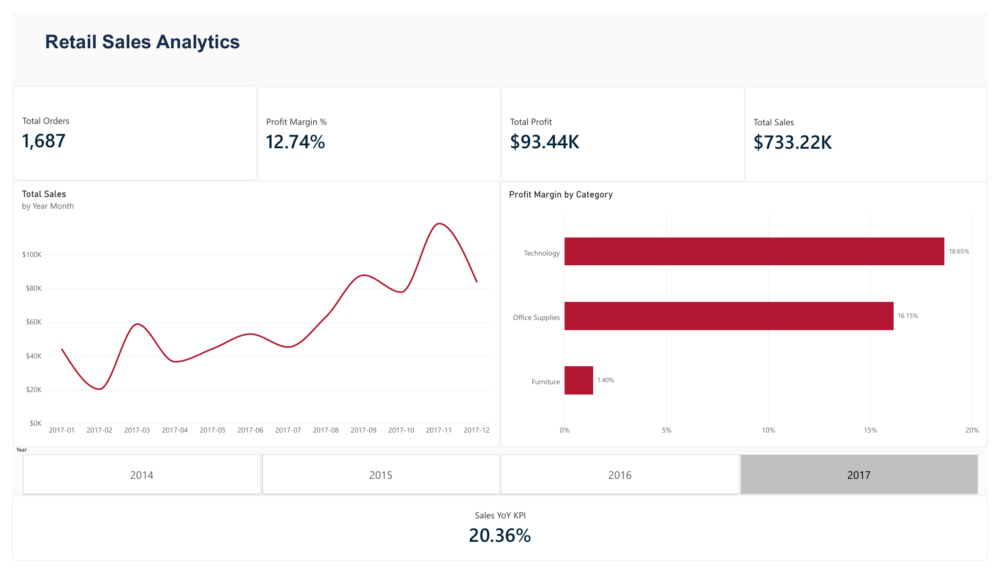
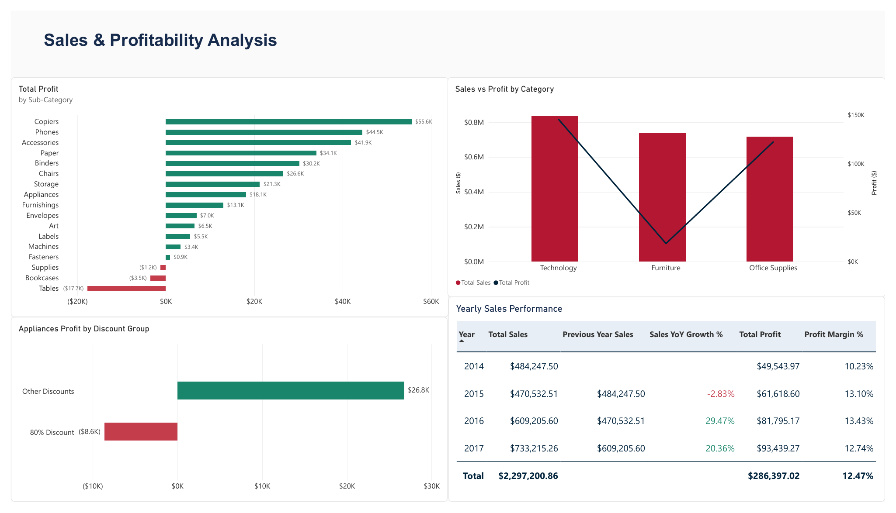
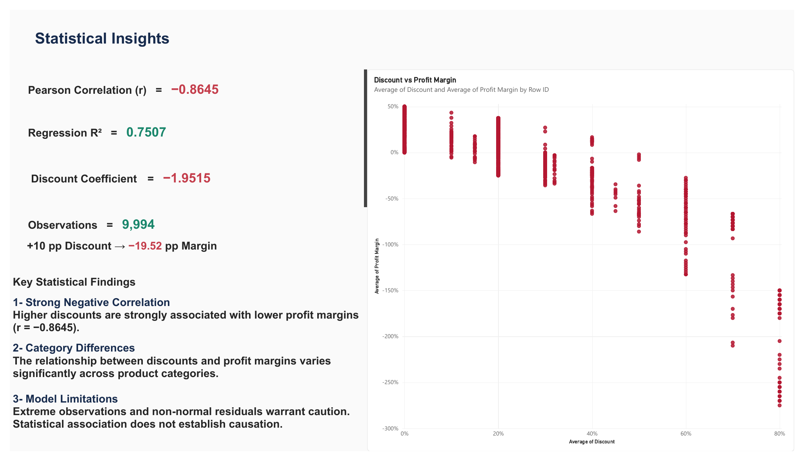

# Retail Sales & Profitability Analysis

**Exploring retail performance, discount behavior, and profit margins with Python and Power BI.**

This portfolio project combines an interactive business-intelligence report with statistical analysis. It investigates which product categories are profitable, how sales performance changes over time, and how discounts are associated with profit margins.

> **Dataset:** 9,994 retail transaction-line records, covering 2014–2017. These are historical sample data, not current retail performance. The data source and its redistribution license should be verified before publishing the raw CSV.

## Dashboard preview

### 1. Executive Overview



Shows sales, profits, orders, profit margin, trends, category profitability, and year selection. The exported preview is filtered to **2017**, whereas the full-dataset statistical results below cover **2014–2017**.

### 2. Sales & Profitability



Examines annual performance, profit by sub-category, sales versus profit by category, and an **Appliances** discount case study.

### 3. Statistical Insights



Visualizes the discount–profit-margin relationship and summarizes results calculated in Python.

[View the full Power BI report (PDF)](Retail_Sales_Analytics.pdf)

## Research question

**How are discounts associated with profit margins across retail product categories?**

Supporting questions:
- Which categories and sub-categories generate the most profit or loss?
- What is the observed relationship between discount size and line-level profit margin?
- Does this relationship differ between product categories?
- How sensitive are the regression results to extreme observations?

## Key business findings

| Metric | Result | Scope |
| --- | ---: | --- |
| Total sales | **$2,297,200.86** | 2014–2017 |
| Total profit | **$286,397.02** | 2014–2017 |
| Overall profit margin | **12.47%** | 2014–2017 |
| Sales growth (2017 vs 2016) | **20.36%** | 2017 |

**Sub-category profitability.** Copiers earned approximately **$55.6K** in total profit, while Tables lost approximately **$17.7K**, with Bookcases and Supplies also recording aggregate losses.

**Discount case study (Appliances).** In the Python analysis, the **80% discount** group contained **67 records**, all loss-making, and generated **−$8,629.64** in total profit. The **other-discounts** group contained **399 records** and generated **+$26,767.65** in total profit. These are descriptive comparisons, **not** a causal estimate of the effect of changing discounts.

## Statistical approach and findings

The Python workflow included descriptive statistics, Pearson correlation, linear regression, models incorporating product-category differences and interactions, and sensitivity and residual diagnostics.

| Analysis | Result | Interpretation |
| --- | ---: | --- |
| Pearson correlation (discount vs profit margin) | **r = −0.8645** | Strong negative linear association in the sample. |
| Simple linear regression | **R² = 0.7473** | In-sample explanatory fit of the simple model. |
| Multiple regression | **R² = 0.7507** | In-sample explanatory fit for the expanded model. |
| Discount coefficient (multiple regression) | **−1.9515** | A +10 percentage-point difference in discount is associated with about **−19.52 percentage points** in predicted margin, conditional on the fitted model. |
| Category interaction model | **R² = 0.7649** | The modeled discount–margin relationship varies by category. |
| Sensitivity analysis (reduced sample) | **R² = 0.7285** | Results change when extreme observations are removed. |

The interaction analysis identified statistically significant category differences. The coefficient estimates varied between Furniture, Office Supplies, and Technology. The diagnostic plots also showed substantial departures from normality in the residuals and extreme negative margins; these limitations matter for inference and generalization.

**Important:** The regression results are observational associations, not causal evidence. The model-fit values are **in-sample**, not out-of-sample predictive accuracy. Highly negative profit margins can occur when losses exceed sales amounts. Inferential results should be assessed in light of model assumptions and influential observations.

## Tools and workflow

- **Python:** data validation, descriptive statistics, hypothesis testing, regression, interaction and sensitivity analysis, and diagnostics.
- **Power BI Desktop:** data modeling, DAX measures, report visuals, interactive slicers, and financial KPIs.
- **Dataset:** `Superstore.csv` (local project file, not included here pending redistribution/license verification).

### Reproduction status

This repository package initially contains the **dashboard screenshots and exported report**, but the following original local project files **must be added before the repository can be called fully reproducible**:

1. `scripts/statistical_analysis.py` — the actual script from the local VS Code project. Do not substitute a reconstructed script.
2. `powerbi/Retail_Sales_Analytics.pbix` — the original editable Power BI report.
3. A verified Python dependency list (`requirements.txt`) based on imports in the actual script.
4. Dataset provenance, access instructions, and redistribution terms. Add the CSV only if its license permits it.

Do not commit credentials, personal paths, connection strings, or other sensitive files. If data cannot be redistributed, provide a documented acquisition link and setup instructions instead.

### Running the Python analysis (after adding the original files)

From the project root, create an environment and install the dependencies verified for your script. Ensure the dataset path in the script points to a file you are authorized to use. The local code previously used an explicit CSV encoding; retain the encoding that successfully loads your copy of the data.

```bash
python -m venv .venv
# Activate the environment for your operating system, then:
pip install -r requirements.txt
python scripts/statistical_analysis.py
```

The above commands will work **only after** you have added the original Python script, a valid `requirements.txt`, and obtained the data in the path expected by that script.

## Scope and reporting notes

- Dashboard pages 1 and 2 are interactive **in the PBIX report**; this exported PDF is static.
- The Executive Overview screenshot currently displays **2017**, while the Python statistical summary reflects all **9,994** observations across 2014–2017.
- Text-based statistical values shown in Power BI were transferred from Python and do **not** automatically update with Power BI filters.
- Currency is displayed in USD, consistent with the project report.

## Repository contents

```text

retail-sales-statistical-analysis/
├── README.md
├── statistical_analysis.py
├── Retail_Sales_Analytics.pbix
├── Retail_Sales_Analytics.pdf
├── requirements.txt
├── executive-overview.png
├── sales-profitability.png
└── statistical-insights.png

```

## How to Run the Analysis

1. Download or clone this repository.
2. Install the required Python packages:

   pip install -r requirements.txt

3. Place Superstore.csv in the project directory.
4. Run the statistical analysis:

   python statistical_analysis.py

## Project Files

- statistical_analysis.py — Python statistical analysis
- Retail_Sales_Analytics.pbix — Power BI dashboard
- Retail_Sales_Analytics.pdf — Dashboard PDF
- requirements.txt — Python dependencies

Note: The original CSV dataset is not included.

## Access the Project

- [Python Analysis](statistical_analysis.py)
- [Power BI Dashboard](Retail_Sales_Analytics.pbix)
- [Dashboard PDF](Retail_Sales_Analytics.pdf)
- [Python Requirements](requirements.txt)


## Acknowledgment and limitations

This is a personal learning/portfolio analysis using historical retail sample records, not an audit or a recommendation to modify real-world pricing without further validation. Confirm the original data attribution and license before public distribution.
